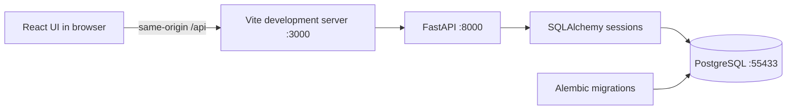
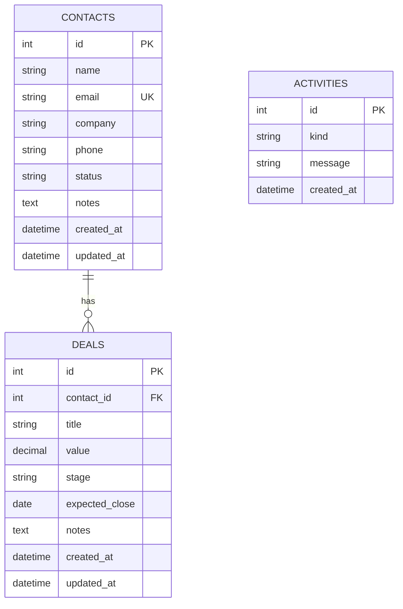

# Application architecture

The frontend has four hash-based views: Overview, Contacts, Pipeline, and Activity. A successful mutation invalidates mounted queries through a shared version counter. Debounced search and server-side pagination keep record lists bounded. Each pipeline column is independently paginated. A form's contact lookup searches across the entire contact collection.

The API owns input validation and all financial aggregates. Amounts are validated as decimals and serialized as decimal strings. Each request gets a database session. Mutations and activity records commit together; constraint conflicts roll back together.

## Schema

Contact deletion is restricted by both API checks and the database foreign key. Activities retain a text description when the underlying record is deleted, without dangling foreign keys. They are a useful workspace history, not a compliance-grade audit log.

## API map

| Method | Path | Behavior |
|---|---|---|
| GET | `/api/contacts` | Search, relationship filter, offset/limit pagination |
| POST | `/api/contacts` | Create a contact |
| GET / PUT / DELETE | `/api/contacts/{id}` | Read, replace editable fields, or delete |
| GET | `/api/deals` | Search, stage/contact filter, offset/limit pagination |
| POST | `/api/deals` | Create a linked opportunity |
| GET / PUT / DELETE | `/api/deals/{id}` | Read, replace editable fields, or delete |
| PATCH | `/api/deals/{id}/stage` | Change stage without replacing other fields |
| GET | `/api/dashboard` | All-time aggregates, stage totals, upcoming deals, recent activity |
| GET | `/api/activities` | Newest first, offset/limit pagination |
| GET | `/health` | Process liveness, independent of database availability |
| GET | `/ready` | Database connectivity and application-table availability |
| GET | `/metrics` | Prometheus request count and latency metrics |

Full schemas and examples are generated at `/docs`. Successful creates return 201; deletes return 204. Unknown records return 404, conflicts 409, and invalid input 422. Database failures return a generic 503 without exposing connection details.

## Boundaries for this phase

This is one trusted local workspace. Authentication, authorization, teams, imports, emails, scheduled jobs, and deployment automation are intentionally not part of this milestone. The next phase can package the existing API and frontend independently and run the same migrations against PostgreSQL. Local development credentials and example values must be replaced before any future hosted environment.
